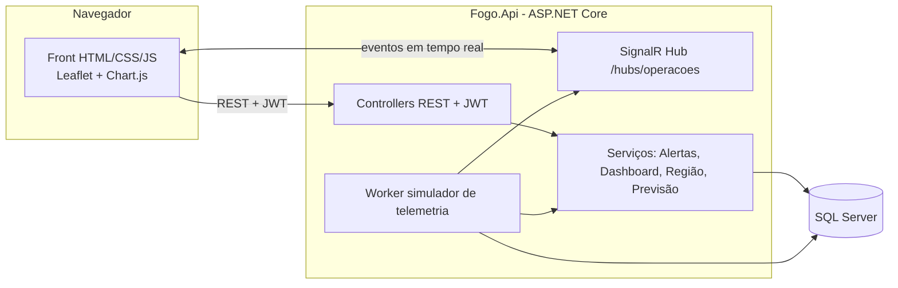

# PROMETHEUS F.O.G.O. — Ferramenta Onisciente de Gestão e Operações

> Plataforma de gestão, monitoramento em tempo real e previsão de equipamentos e agentes de trânsito e segurança, aplicada à cidade de **Marília/SP**.
> Projeto do **Coder Challenge 2026 – Desafio F.O.G.O.** · Autor: **Kaique Sasaki de Campos**

**Status das partes**

| Parte | Descrição | Status |
|---|---|---|
| 1 | Inventário Inteligente da Cidade | ✅ Concluída |
| 2 | Central de Operações da Cidade | ✅ Concluída |
| 3 | Cidade Preditiva | ✅ Concluída |

---

## 1. Resumo para avaliadores (leitura de 1 minuto)

**O problema:** a cidade tem dezenas de tipos de equipamentos (radares, câmeras, balanças, totens, patinetes, viaturas...) e de agentes em campo, mas sem uma visão única do que está funcionando, do que falhou e do que precisa de manutenção.

**A solução:** o F.O.G.O. cadastra tudo isso (Parte 1) e transforma os dados em uma **central de comando em tempo real** (Parte 2). Ela responde à pergunta do desafio: *"se algo estiver acontecendo na cidade agora, PROMETHEUS conseguirá perceber?"* Quando um equipamento falha, é furtado ou perde comunicação, o mapa, os alertas e os indicadores mudam **sem recarregar a página**. A Parte 3 usa o histórico para responder à pergunta seguinte: **"o que pode acontecer amanhã?"**. Ela indica onde e quando o risco será maior, quantos agentes serão necessários, quais equipamentos devem falhar primeiro e quais comportamentos fogem do padrão, sempre **explicando o método e os dados usados**.

**O que dá para ver em 5 minutos** (roteiro completo na seção 5):
1. Login simples, com passo a passo na própria tela.
2. Mapa de Marília com todos os equipamentos e agentes, coloridos pela situação.
3. Botão de **modo demonstração**: simula um furto de radar e o sistema reage ao vivo.
4. Cadastro de um equipamento novo, com campos que mudam conforme o tipo.
5. **Inteligência Preditiva**: mapa de risco por faixa horária, fluxo previsto, manutenção preditiva, anomalias e recomendações.

---

## 2. Funcionalidades

### Parte 1 — Inventário Inteligente
- Cadastro, edição, exclusão, busca, filtros e paginação de equipamentos de **13 tipos**: radar, câmera, balança de caminhão, veículo autônomo de fiscalização, cancela/portão automatizado, táxi, mototáxi, transporte escolar, totem de estacionamento, patinete, moto de agente, viatura da Guarda Municipal e viatura da Polícia Militar.
- Dados de cada equipamento: tipo, número de série, marca, modelo, localização (CEP, bairro, cidade/UF, rua, referência e coordenadas GPS), situação, necessidade e data da próxima manutenção.
- **Características específicas por tipo** (ex.: visão noturna e resolução da câmera, velocidade máxima do radar), geradas dinamicamente no formulário.
- Preenchimento automático de endereço pelo CEP e escolha das coordenadas clicando no mapa.
- Cadastro de **agentes** (agentes de trânsito, guardas municipais e policiais).

### Parte 2 — Central de Operações
- **Mapa** com ícone por tipo e anel colorido pela situação (operacional, mau funcionamento, em manutenção, desativado, furtado, não instalado), com agrupamento (cluster) e mapa de calor.
- **Indicadores:** total de equipamentos, operacionais, indisponíveis, % de disponibilidade, agentes em campo, alertas ativos, ocorrências do dia.
- **Filtros:** tipo, situação, região, bairro, órgão responsável, busca livre e manutenção.
- **Alertas** por criticidade (Crítico, Atenção, Info), com regras automáticas (furto, mau funcionamento, equipamento sem comunicação, manutenção vencida ou próxima) e ações de reconhecer e resolver.
- **Painel de manutenção** e **saúde por região** (Normal, Atenção, Crítico), respondendo "quais regiões exigem atenção agora?".
- **Detalhes** de qualquer equipamento ou agente direto pelo mapa.
- **Tempo real** via SignalR: mapa, alertas, indicadores e feed ao vivo atualizam sozinhos.
- **Modo demonstração:** simula furto, falha e queda de comunicação, e restaura.

### Parte 3 — Cidade Preditiva
Cinco previsões, todas com estatística simples e **explicável** (sem modelos opacos). Cada painel tem o botão **"Como funciona"**, que mostra *o que é previsto*, *quais dados foram usados* e *como a previsão ajuda a decidir*. Detalhes na seção 7.
- **Risco por região e faixa horária** no mapa, para o dia escolhido (padrão: amanhã).
- **Fluxo previsto** de ocorrências por hora (Hoje × Amanhã (IA) × Semana) e agentes recomendados.
- **Manutenção preditiva:** equipamentos com maior risco de falha e % da frota em risco.
- **Detecção de anomalias:** horas e regiões fora do padrão histórico.
- **Recomendações automáticas** priorizadas: reforçar agentes, programar manutenção, investigar anomalias e restaurar equipamentos.

---

## 3. Arquitetura e tecnologias

| Camada | Tecnologia |
|---|---|
| Front-end | HTML, CSS e JavaScript (ES Modules), Leaflet (+ markercluster e heat), Chart.js, cliente SignalR |
| Back-end | C# / ASP.NET Core Web API, Entity Framework Core, autenticação JWT, SignalR, Swagger |
| Banco de dados | SQL Server (LocalDB no desenvolvimento) |
| Mapas e geografia | OpenStreetMap (tiles CARTO Dark), ViaCEP (endereço por CEP) |

**Decisões de projeto**
- **Um único deploy:** o front fica na pasta `wwwroot` da própria API (mesma origem, sem CORS).
- **Contrato único:** rotas, campos, enums e eventos estão definidos em [`docs/00-CONTRATO-API.md`](docs/00-CONTRATO-API.md), o que mantém front e back padronizados.
- **Tempo real sem polling:** o servidor envia eventos (`EquipamentoAtualizado`, `AlertaCriado`, `ResumoAtualizado` etc.) pelo SignalR.
- **Características por tipo em JSON:** cada tipo de equipamento descreve seus campos (`camposSchema`), e o formulário se monta sozinho. Novos tipos não exigem mudar o banco.
- **Previsões explicáveis:** cada resposta de `/api/previsao/*` traz o bloco `explicacao` (`oQuePreve`, `dadosUsados`, `comoAjuda`) e o motivo de cada pontuação (`fatores`).

**Documentação complementar**
- [`docs/00-CONTRATO-API.md`](docs/00-CONTRATO-API.md): contrato completo da API (rotas, DTOs, enums e eventos em tempo real).
- [`README-front.md`](README-front.md): documentação do front-end gerada pelo Antigravity (estrutura de pastas, IDs principais por página e modo mock).
- **Swagger:** http://localhost:5080/swagger (com o sistema em execução).

---

## 4. Como executar

### Pré-requisitos
- **Visual Studio 2022 ou mais recente**, com as cargas de trabalho *ASP.NET e desenvolvimento para a Web* e *Armazenamento e processamento de dados* (inclui o SQL Server LocalDB).
- **SDK do .NET** compatível com o projeto (o Visual Studio indica se faltar).
- Internet para os mapas, as fontes e as bibliotecas por CDN.

### Passo a passo
1. Clone o repositório: `git clone <URL-DO-REPOSITÓRIO>`
2. Abra a solução **`Fogo.sln`** no Visual Studio.
3. Selecione o perfil **http** na barra de ferramentas e aperte **F5**.
4. Na **primeira execução**, o sistema cria o banco `FogoDb` e popula os dados de demonstração (pode levar até 1 minuto).
5. O navegador abre em **http://localhost:5080/login.html**.

Alternativa pelo terminal, na pasta do projeto da API (`Fogo.Api`): `dotnet run --launch-profile http`.

### Acesso

| | |
|---|---|
| **Sistema** | http://localhost:5080/login.html |
| **Documentação da API (Swagger)** | http://localhost:5080/swagger |
| **Conta de demonstração** | `admin@fogo.local` / `Fogo@2026` |
| **Conta própria** | Na tela de login, aba **Criar conta** (senha com mínimo de 8 caracteres, letra e número). Você já entra automaticamente. |

### Problemas comuns
| Sintoma | Solução |
|---|---|
| Erro de banco ao iniciar | Confirme que o LocalDB está instalado (Visual Studio → *Exibir → Gerenciador de Objetos do SQL Server*) |
| Quer recomeçar os dados | Apague o banco `FogoDb` no Gerenciador de Objetos do SQL Server e rode de novo: ele é recriado e populado |
| Mapa sem fundo | Verifique a conexão com a internet (os tiles vêm do CARTO/OpenStreetMap) |
| Tela de login diz "servidor indisponível" | A API não está rodando ou a porta mudou. Use o perfil `http` (porta 5080) |
| Previsões vazias ou sem variação | O histórico de 90 dias não foi gerado. Apague o banco `FogoDb` e rode de novo |

---

## 5. Roteiro de demonstração para avaliadores (≈ 5 min)

| # | O que fazer | O que observar |
|---|---|---|
| 1 | Abra o sistema e entre (conta demo ou criando conta) | Passo a passo na tela de login e status da API |
| 2 | **Centro de Operações**: observe indicadores, lista de tipos e mapa | Ícones por tipo, cores por situação, cluster |
| 3 | Aplique filtros (tipo, região, situação) e clique em um marcador | Mapa filtrado e painel lateral com os detalhes completos |
| 4 | Clique em **Modo demonstração → Simular furto** | Alerta crítico aparece na hora, o marcador pulsa, os KPIs e a região mudam, o feed registra o evento. **Tudo sem recarregar** |
| 5 | Veja **manutenção** e **saúde por região** | Priorização de ações ("onde atuar agora?") |
| 6 | Clique em **Restaurar** | Estado e alertas voltam ao normal |
| 7 | Em **Equipamentos**, crie um equipamento novo | Campos dinâmicos por tipo, CEP automático e coordenada por clique no mapa; o item aparece no mapa |
| 8 | Em **Agentes**, veja a lista e a troca de status | Cadastro e acompanhamento dos agentes |
| 9 | Abra **Inteligência Preditiva** | Mapa de risco por faixa horária, fluxo previsto, equipamentos em risco, anomalias e recomendações |
| 10 | Escolha uma **sexta-feira** no seletor de data | O risco `Alto` se concentra no fim da tarde e à noite, no Centro e na região Sul (padrão do histórico) |
| 11 | Simule um **mau funcionamento** (modo demo) e clique em **Atualizar previsões** | O equipamento sobe no ranking de manutenção e as recomendações refletem o que acabou de acontecer |
| 12 | Clique em **ℹ Como funciona** em qualquer painel | O que é previsto, quais dados foram usados e como ajuda na decisão |

### Onde cada critério de avaliação aparece

| Critério | Onde ver |
|---|---|
| Resolver o problema proposto | Partes 1, 2 e 3 completas, da catalogação à previsão, com a pergunta do desafio demonstrada no modo demo |
| Criatividade e inovação | Modo demonstração, formulário dinâmico por tipo, saúde por região, mapa de calor, previsões que reagem ao que acontece na cidade |
| Efetividade | Alertas com regras automáticas, priorização de manutenção e recomendações acionáveis |
| Desempenho | Cluster no mapa, paginação no banco, atualização só do item afetado, resumo com limite de frequência, cache das previsões |
| Qualidade técnica | Contrato de API único, JWT, migrações, índices no banco, Swagger, código organizado em camadas |
| Experiência de uso | Tema escuro de central de comando, login guiado, filtros, explicação em cada previsão, responsivo (desktop, tablet e celular) |

---

## 6. Dados utilizados (transparência)

- **Reais:** ruas, bairros e semáforos de Marília extraídos do **OpenStreetMap**, baixados uma vez e guardados no projeto. O sistema não depende de APIs de dados em tempo de execução.
- **Fictícios, inspirados na realidade:** os ~245 equipamentos, ~45 agentes, alertas, ocorrências e 90 dias de histórico são **gerados por um script** reproduzível (semente fixa). **Não são dados oficiais da Prefeitura ou da Emdurb.** Números de série, CEPs e características são ilustrativos.
- O histórico possui **padrões embutidos de propósito** (picos em horários e regiões específicas, um modelo de radar com mais falhas, dias atípicos), para que as previsões da Parte 3 tenham o que identificar. Isso deve ser lido como demonstração do método, não como conclusão sobre a cidade real.
- Em ambiente real, o simulador de telemetria seria substituído pelos dados enviados pelos dispositivos IoT.

---

## 7. Parte 3 — Cidade Preditiva (como funciona)

As previsões usam **regras e estatística simples**, escolhidas por serem transparentes: cada pontuação vem acompanhada dos fatores que a explicam. Todas as rotas exigem autenticação e ficam em cache por 5 minutos (o botão **Atualizar previsões** ignora o cache).

| # | Previsão | O que prevê | Dados usados | Como ajuda na decisão |
|---|---|---|---|---|
| 1 | **Risco por região e faixa horária** | Nível de risco (Baixo, Médio, Alto; índice de 0 a 100) de ocorrências por região em faixas de 2 h, para o dia escolhido | Ocorrências dos últimos 90 dias no mesmo dia da semana, com mais peso aos últimos 14 dias e à gravidade; disponibilidade de equipamentos da região | Mostra **onde e quando** concentrar agentes |
| 2 | **Fluxo previsto e demanda de agentes** | Ocorrências esperadas por hora (Hoje × Amanhã (IA) × média da semana) e agentes recomendados | Média histórica da hora no mesmo dia da semana; agentes em campo no momento | Dimensiona o **efetivo necessário** por hora |
| 3 | **Manutenção preditiva** | Índice de risco de falha por equipamento e % da frota em risco | Taxa de falhas do modelo (até 40 pts), manutenção atrasada (25), falhas dos últimos 30 dias (25) e situação atual (10) | **Prioriza** quais equipamentos revisar antes de falharem |
| 4 | **Detecção de anomalias** | Horas e regiões com ocorrências muito acima do esperado | *z-score* contra o histórico da mesma região, dia da semana e hora (anomalia: z ≥ 2,5 e ao menos 3 ocorrências) | Alerta sobre **comportamentos fora do padrão** que podem indicar um problema |
| 5 | **Recomendações automáticas** | Lista priorizada de ações (Alta, Média, Baixa) | Saídas das previsões 1, 3 e 4 e a saúde atual das regiões | Transforma a previsão em **ação concreta** |

**Rotas**

| Rota | Parâmetros |
|---|---|
| `GET /api/previsao/risco-regioes` | `data` (padrão: amanhã) |
| `GET /api/previsao/demanda-agentes` | `data` (padrão: amanhã) |
| `GET /api/previsao/manutencao` | `top` (padrão: 20) |
| `GET /api/previsao/anomalias` | `dias` (padrão: 7) |
| `GET /api/previsao/recomendacoes` | — |

Todas aceitam `forcar=true` e devolvem `geradoEm` e `explicacao`.

**Limitações assumidas:** os índices são ferramentas de **priorização**, não probabilidades calibradas; o histórico é sintético; e o método é propositalmente simples. Com dados reais, o passo seguinte seria treinar e validar modelos estatísticos ou de machine learning, mantendo a explicabilidade.

---

## 8. Uso de Inteligência Artificial

| Ferramenta | Onde foi usada |
|---|---|
| **Gemini Flash 3.6** | Geração do código do back-end (entidades, DTOs, serviços, controllers, seed de dados, simulador e previsões) |
| **Antigravity** | Geração do código do front-end e do `README-front.md` |
| **Claude (Anthropic)** | Apoio no planejamento da arquitetura, na definição do contrato da API e na documentação |

A estrutura do projeto, as configurações (pacotes, banco de dados, autenticação e `Program.cs`), a integração entre front-end e back-end, os testes e a revisão do código gerado foram feitos manualmente pelo autor, que se responsabiliza pelo entendimento de todo o código entregue.

---

## 9. Telas

| Tela | Imagem |
|---|---|
| Login |  |
| Centro de Operações |  |
| Inventário |  |
| Alerta em tempo real (modo demo) |  |
| Inteligência Preditiva |  |

---

## 10. Limitações e próximos passos

- Os dados são sintéticos e o simulador de telemetria faz o papel dos dispositivos IoT.
- A autenticação é simples (perfis `Admin` e `Gestor`, ambos com as mesmas permissões).
- A chave JWT do `appsettings.json` é **somente de desenvolvimento** e deve ser trocada em produção.
- As previsões são heurísticas explicáveis, não modelos treinados e validados.
- Próximos passos: integração com os dispositivos reais, perfis com permissões distintas, notificações para as equipes em campo, publicação de alertas preventivos (`Anomalia`) em tempo real e modelos de previsão treinados com dados reais.

---

## 11. Autor

| Nome | Responsabilidade |
|---|---|
| **Kaique Sasaki de Campos** | Projeto individual: arquitetura, back-end, banco de dados, front-end, integração, testes e documentação |
