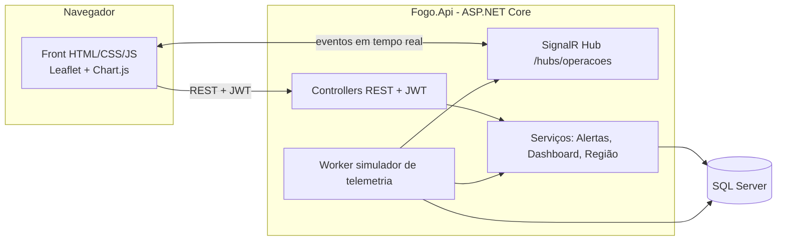

# PROMETHEUS F.O.G.O. — Ferramenta Onisciente de Gestão e Operações

> Plataforma de gestão e monitoramento em tempo real de equipamentos e agentes de trânsito e segurança, aplicada à cidade de **Marília/SP**.
> Projeto do **Coder Challenge 2026 – Desafio F.O.G.O.**

**Status das partes**

| Parte | Descrição | Status |
|---|---|---|
| 1 | Inventário Inteligente da Cidade | ✅ Concluída |
| 2 | Central de Operações da Cidade | ✅ Concluída |
| 3 | Cidade Preditiva | ⏳ Em desenvolvimento *(atualizar esta linha ao concluir)* |

---

## 1. Resumo para avaliadores (leitura de 1 minuto)

**O problema:** a cidade tem dezenas de tipos de equipamentos (radares, câmeras, balanças, totens, patinetes, viaturas...) e de agentes em campo, mas sem uma visão única do que está funcionando, do que falhou e do que precisa de manutenção.

**A solução:** o F.O.G.O. cadastra tudo isso (Parte 1) e transforma os dados em uma **central de comando em tempo real** (Parte 2). Ela responde à pergunta do desafio: *"se algo estiver acontecendo na cidade agora, PROMETHEUS conseguirá perceber?"* Quando um equipamento falha, é furtado ou perde comunicação, o mapa, os alertas e os indicadores mudam **sem recarregar a página**. A Parte 3 usa o histórico para antecipar o que pode acontecer.

**O que dá para ver em 5 minutos** (roteiro completo na seção 5):
1. Login simples, com passo a passo na própria tela.
2. Mapa de Marília com todos os equipamentos e agentes, coloridos pela situação.
3. Botão de **modo demonstração**: simula um furto de radar e o sistema reage ao vivo.
4. Cadastro de um equipamento novo, com campos que mudam conforme o tipo.

---

## 2. Funcionalidades

### Parte 1 — Inventário Inteligente
- Cadastro, edição, exclusão, busca, filtros e paginação de equipamentos de **13 tipos**: radar, câmera, balança de caminhão, veículo autônomo de fiscalização, cancela/portão automatizado, táxi, mototáxi, transporte escolar, totem de estacionamento, patinete, moto de agente, viatura da Guarda Municipal e viatura da Polícia Militar.
- Dados de cada equipamento: tipo, número de série, marca, modelo, localização (CEP, bairro, cidade/UF, rua, referência e coordenadas GPS), situação, necessidade e data da próxima manutenção.
- **Características específicas por tipo** (ex.: visão noturna e resolução da câmera, velocidade máxima do radar), geradas dinamicamente no formulário.
- Preenchimento automático de endereço pelo CEP e escolha das coordenadas clicando no mapa.
- Cadastro de **agentes** (agentes de trânsito, guardas municipais e policiais).

### Parte 2 — Central de Operações
- **Mapa** com ícone por tipo e anel colorido pela situação (operacional, mau funcionamento, em manutenção, desativado, furtado, não instalado), com agrupamento (cluster) e mapa de calor.
- **Indicadores:** total de equipamentos, operacionais, indisponíveis, % de disponibilidade, agentes em campo, alertas ativos, ocorrências do dia.
- **Filtros:** tipo, situação, região, bairro, órgão responsável, busca livre e manutenção.
- **Alertas** por criticidade (Crítico, Atenção, Info), com regras automáticas (furto, mau funcionamento, equipamento sem comunicação, manutenção vencida ou próxima) e ações de reconhecer e resolver.
- **Painel de manutenção** e **saúde por região** (Normal, Atenção, Crítico), respondendo "quais regiões exigem atenção agora?".
- **Detalhes** de qualquer equipamento ou agente direto pelo mapa.
- **Tempo real** via SignalR: mapa, alertas, indicadores e feed ao vivo atualizam sozinhos.
- **Modo demonstração:** simula furto, falha e queda de comunicação, e restaura.

### Parte 3 — Cidade Preditiva
<!-- TODO (equipe): substituir este bloco pelo que foi implementado. Para cada previsão, informe: o que prevê, quais dados usa e como ajuda na decisão. -->
*Em desenvolvimento.* Veja a seção 7 para o plano e o checklist.

---

## 3. Arquitetura e tecnologias



| Camada | Tecnologia |
|---|---|
| Front-end | HTML, CSS e JavaScript (ES Modules), Leaflet (+ markercluster e heat), Chart.js, cliente SignalR |
| Back-end | C# / ASP.NET Core Web API, Entity Framework Core, autenticação JWT, SignalR, Swagger |
| Banco de dados | SQL Server (LocalDB no desenvolvimento) |
| Mapas e geografia | OpenStreetMap (tiles CARTO Dark), ViaCEP (endereço por CEP) |

**Decisões de projeto**
- **Um único deploy:** o front fica na pasta `wwwroot` da própria API (mesma origem, sem CORS).
- **Contrato único:** rotas, campos, enums e eventos estão definidos em [`docs/00-CONTRATO-API.md`](docs/00-CONTRATO-API.md), o que mantém front e back padronizados.
- **Tempo real sem polling:** o servidor envia eventos (`EquipamentoAtualizado`, `AlertaCriado`, `ResumoAtualizado` etc.) pelo SignalR.
- **Características por tipo em JSON:** cada tipo de equipamento descreve seus campos (`camposSchema`), e o formulário se monta sozinho. Novos tipos não exigem mudar o banco.

---

## 4. Como executar

### Pré-requisitos
- **Visual Studio 2022 ou mais recente**, com as cargas de trabalho *ASP.NET e desenvolvimento para a Web* e *Armazenamento e processamento de dados* (inclui o SQL Server LocalDB).
- **SDK do .NET** compatível com o projeto (o Visual Studio indica se faltar).
- Internet para os mapas, as fontes e as bibliotecas por CDN.

### Passo a passo
1. Clone o repositório: `git clone <URL-DO-REPOSITÓRIO>`
2. Abra a solução **`Fogo.sln`** no Visual Studio.
3. Selecione o perfil **http** na barra de ferramentas e aperte **F5**.
4. Na **primeira execução**, o sistema cria o banco `FogoDb` e popula os dados de demonstração (pode levar até 1 minuto).
5. O navegador abre em **http://localhost:5080/login.html**.

Alternativa pelo terminal, dentro da pasta `Fogo.Api`: `dotnet run --launch-profile http`.

### Acesso

| | |
|---|---|
| **Sistema** | http://localhost:5080/login.html |
| **Documentação da API (Swagger)** | http://localhost:5080/swagger |
| **Conta de demonstração** | `admin@fogo.local` / `Fogo@2026` |
| **Conta própria** | Na tela de login, aba **Criar conta** (senha com mínimo de 8 caracteres, letra e número). Você já entra automaticamente. |

### Problemas comuns
| Sintoma | Solução |
|---|---|
| Erro de banco ao iniciar | Confirme que o LocalDB está instalado (Visual Studio → *Exibir → Gerenciador de Objetos do SQL Server*) |
| Quer recomeçar os dados | Apague o banco `FogoDb` no Gerenciador de Objetos do SQL Server e rode de novo: ele é recriado e populado |
| Mapa sem fundo | Verifique a conexão com a internet (os tiles vêm do CARTO/OpenStreetMap) |
| Tela de login diz "servidor indisponível" | A API não está rodando ou a porta mudou. Use o perfil `http` (porta 5080) |

---

## 5. Roteiro de demonstração para avaliadores (≈ 5 min)

| # | O que fazer | O que observar |
|---|---|---|
| 1 | Abra o sistema e entre (conta demo ou criando conta) | Passo a passo na tela de login e status da API |
| 2 | **Centro de Operações**: observe indicadores, lista de tipos e mapa | Ícones por tipo, cores por situação, cluster |
| 3 | Aplique filtros (tipo, região, situação) e clique em um marcador | Mapa filtrado e painel lateral com os detalhes completos |
| 4 | Clique em **Modo demonstração → Simular furto** | Alerta crítico aparece na hora, o marcador pulsa, os KPIs e a região mudam, o feed registra o evento. **Tudo sem recarregar** |
| 5 | Veja **manutenção** e **saúde por região** | Priorização de ações ("onde atuar agora?") |
| 6 | Clique em **Restaurar** | Estado e alertas voltam ao normal |
| 7 | Em **Equipamentos**, crie um equipamento novo | Campos dinâmicos por tipo, CEP automático e coordenada por clique no mapa; o item aparece no mapa |
| 8 | Em **Agentes**, veja a lista e a troca de status | Cadastro e acompanhamento dos agentes |
| 9 | Abra **Inteligência Preditiva** | Previsões da Parte 3 *(atualizar quando concluída)* |

### Onde cada critério de avaliação aparece

| Critério | Onde ver |
|---|---|
| Resolver o problema proposto | Partes 1 e 2 completas, com a pergunta do desafio demonstrada no modo demo |
| Criatividade e inovação | Modo demonstração, formulário dinâmico por tipo, saúde por região, mapa de calor |
| Efetividade | Alertas com regras automáticas e priorização de manutenção |
| Desempenho | Cluster no mapa, paginação no banco, atualização só do item afetado, resumo com limite de frequência |
| Qualidade técnica | Contrato de API único, JWT, migrações, índices no banco, Swagger, código organizado em camadas |
| Experiência de uso | Tema escuro de central de comando, login guiado, filtros, responsivo (desktop, tablet e celular) |

---

## 6. Dados utilizados (transparência)

- **Reais:** ruas, bairros e semáforos de Marília extraídos do **OpenStreetMap**, baixados uma vez e guardados no projeto. O sistema não depende de APIs de dados em tempo de execução.
- **Fictícios, inspirados na realidade:** os ~245 equipamentos, ~45 agentes, alertas, ocorrências e 90 dias de histórico são **gerados por um script** reproduzível (semente fixa). **Não são dados oficiais da Prefeitura ou da Emdurb.** Números de série, CEPs e características são ilustrativos.
- O histórico possui **padrões embutidos de propósito** (picos em horários e regiões específicas, um modelo de radar com mais falhas, dias atípicos), para a Parte 3 conseguir identificá-los.
- Em ambiente real, o simulador de telemetria seria substituído pelos dados enviados pelos dispositivos IoT.

---

## 7. Parte 3 — plano para a equipe concluir

**Material de apoio:** [`docs/03-RESUMO-EQUIPE-E-GUIA-PARTE-3.md`](docs/03-RESUMO-EQUIPE-E-GUIA-PARTE-3.md) (métodos sugeridos, formato das respostas, prompts e boas práticas).

**O que já está pronto para a Parte 3**
- Tabelas `Telemetria` e `Ocorrencia` com 90 dias de histórico.
- Rotas de apoio: `GET /api/historico/telemetria`, `/ocorrencias` e `/serie`.
- Alerta do tipo `Anomalia` e o hub de tempo real, reservados para alertas preventivos.
- Página `previsao.html` com os contêineres reservados: `#prev-risco-mapa`, `#prev-grafico-fluxo`, `#prev-manutencao`, `#prev-anomalias` e `#prev-recomendacoes`.

**Previsões sugeridas (escolher 3 ou 4 e fazer bem-feitas)**

| # | Previsão | Método | Onde aparece |
|---|---|---|---|
| 1 | Índice de risco por região e horário | Média ponderada das ocorrências por região, dia da semana e hora, com mais peso aos últimos 14 dias | `#prev-risco-mapa` |
| 2 | Demanda de reforço de agentes | Média sazonal esperada de ocorrências versus agentes em campo | `#prev-grafico-fluxo` |
| 3 | Manutenção preditiva | Pontuação de risco por equipamento: taxa de falha do modelo, dias sem manutenção, falhas recentes | `#prev-manutencao` |
| 4 | Detecção de anomalias | *z-score* por região, dia da semana e hora | `#prev-anomalias` |
| 5 | Recomendações automáticas | Regras *se-então* sobre as saídas anteriores | `#prev-recomendacoes` |

**Regras do projeto para manter a integração**
1. Toda rota, campo ou enum novo entra **primeiro** em `docs/00-CONTRATO-API.md`.
2. Rotas em `/api/previsao/*`, respostas com `geradoEm` e o bloco `explicacao` (`oQuePrevê`, `dadosUsados`, `comoAjuda`).
3. IDs HTML `prev-*` em kebab-case, funções em camelCase, classes CSS com prefixo `fogo-`, DTOs terminando em `Dto`.
4. Mudanças no banco só por migração (`Add-Migration` e `Update-Database`).

### Checklist final da equipe

| # | Item | Responsável | Status |
|---|---|---|---|
| 1 | Back da Parte 3 (`PrevisaoService` e `PrevisaoController`) | [PREENCHER] | ☐ |
| 2 | Front da Parte 3 (`previsao.html` e `previsao.js`) | [PREENCHER] | ☐ |
| 3 | Atualizar o contrato com as rotas `/api/previsao/*` | [PREENCHER] | ☐ |
| 4 | Atualizar este README (seções 1, 2, 5 e o status no topo) | [PREENCHER] | ☐ |
| 5 | Preencher a seção 8 (uso de IA) e a seção 10 (equipe) | Todos | ☐ |
| 6 | Adicionar prints ou GIFs (seção 9) | [PREENCHER] | ☐ |
| 7 | Teste em outra máquina (clone, F5 e login) | [PREENCHER] | ☐ |
| 8 | Gravar vídeo de backup da demonstração | [PREENCHER] | ☐ |
| 9 | Mover os arquivos `00` a `03` para a pasta `docs/` (os links acima dependem disso) | [PREENCHER] | ☐ |

---

## 8. Uso de Inteligência Artificial

<!-- TODO (equipe): conferir e completar. Cada integrante deve saber explicar o código gerado. -->

| Ferramenta | Onde foi usada | O que a equipe fez/ajustou |
|---|---|---|
| Claude (Anthropic) | Planejamento, definição do contrato da API, roteiros de montagem e documentação | [PREENCHER] |
| Antigravity | Geração do código do front-end a partir do prompt e do contrato | [PREENCHER] |
| [PREENCHER: ferramenta usada no back-end] | Geração das classes do back-end (entidades, serviços, controllers) | [PREENCHER] |

A estrutura do projeto, as configurações, a integração entre front e back e os testes foram feitos manualmente pela equipe.

---

## 9. Telas

<!-- TODO (equipe): adicionar prints em docs/img/ e referenciar aqui. Exemplo:  -->

| Tela | Imagem |
|---|---|
| Login | [PREENCHER] |
| Centro de Operações | [PREENCHER] |
| Inventário | [PREENCHER] |
| Alerta em tempo real (modo demo) | [PREENCHER] |
| Inteligência Preditiva | [PREENCHER] |

---

## 10. Limitações e próximos passos

- Os dados são sintéticos e o simulador de telemetria faz o papel dos dispositivos IoT.
- A autenticação é simples (perfis `Admin` e `Gestor`, ambos com as mesmas permissões).
- A chave JWT do `appsettings.json` é **somente de desenvolvimento** e deve ser trocada em produção.
- Próximos passos: integração com os dispositivos reais, perfis com permissões distintas, notificações para as equipes em campo e modelos de previsão treinados com dados reais.

---

## 11. Equipe

| Nome | Responsabilidade |
|---|---|
| [PREENCHER] | [PREENCHER] |
| [PREENCHER] | [PREENCHER] |
| [PREENCHER] | [PREENCHER] |

---

## 12. Estrutura do repositório

```
/
├── README.md
├── docs/                        00-CONTRATO-API.md, 01-BACKEND-INSTRUCOES.md,
│                                02-FRONTEND-PROMPT-ANTIGRAVITY.md, 03-RESUMO-EQUIPE-E-GUIA-PARTE-3.md
└── Fogo.Api/
    ├── Controllers/  Rotas REST
    ├── Data/         AppDbContext e Seed (dados iniciais)
    ├── Dtos/         Modelos de entrada e saída da API
    ├── Hubs/         SignalR (tempo real)
    ├── Migrations/   Histórico do banco
    ├── Models/       Entidades e enums
    ├── Services/     Regras de negócio (alertas, dashboard, regiões)
    ├── Workers/      Simulador de telemetria
    ├── wwwroot/      Front-end (login, centro de operações, inventário, agentes, previsão)
    ├── appsettings.json
    └── Program.cs
```
